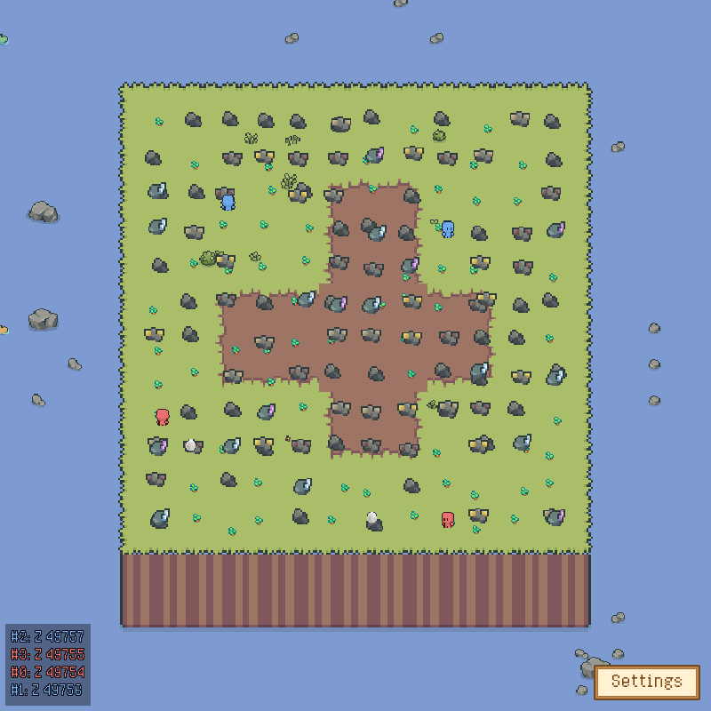
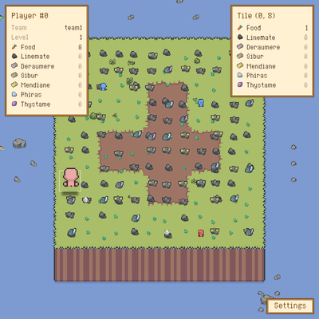
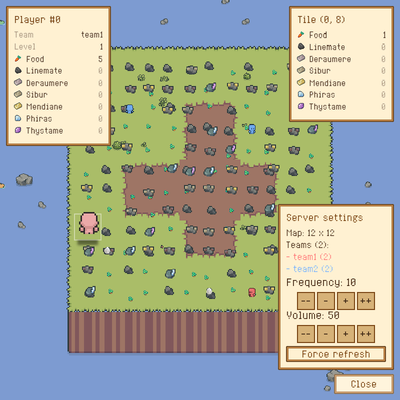

<h1 align="center">Zappy</h1>

<p align="center">
  <strong>A multiplayer island game where teams explore, gather resources and race to level up.</strong>
</p>

<p align="center">
  <a href=".assets/gui-world.png">
    
  </a>
</p>

<p align="center">
  <em>A live 12x12 match with two teams, four AI players and the in-game chat.<br>
  Art: <a href="https://cupnooble.itch.io/sprout-lands-asset-pack">Sprout Lands</a> by Cup Nooble;
  the pack is not included.</em>
</p>

## Screenshots

| Player and tile inspectors | Server settings |
| :---: | :---: |
| [](.assets/gui-inspectors.png) | [](.assets/gui-settings.png) |

## How it works

The server owns the island, players, resources and timed actions. AI clients play
through a TCP protocol. The GUI is a spectator that renders the match and exposes
player, tile and server controls.

## Run it

```sh
make zappy_server zappy_ai
./server/zappy_server -p 4242 -x 12 -y 12 -n team1 team2 -c 3 -f 100
```

In another terminal:

```sh
./ai/zappy_ai -p 4242 -n team1 -h 127.0.0.1
```

Build the GUI, then run it from `gui/` so it finds the assets described in
[`gui/assets/README.md`](gui/assets/README.md):

```sh
make zappy_gui
cd gui
./zappy_gui -p 4242 -h 127.0.0.1
```

See [`BUILD.md`](BUILD.md) for dependencies and tests.

## Docs

[Server](server/doc/index.md), [Protocol](server/doc/protocol.md), [AI](ai/python/README.md)

Credits: [CREDITS.md](CREDITS.md)

## Academic notice

EPITECH students: do not copy this code. Using it as your own work is cheating and can lead to disciplinary action.
